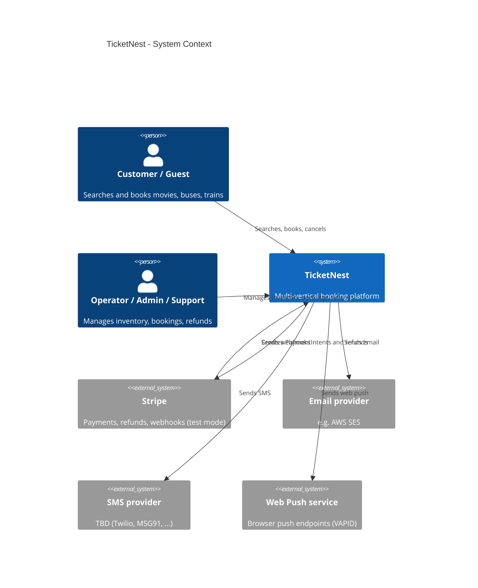
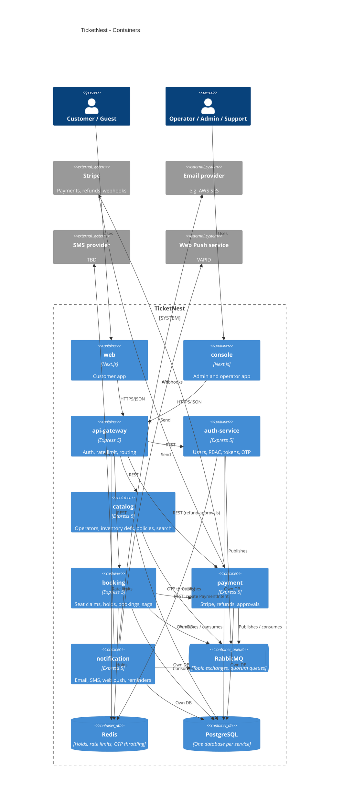
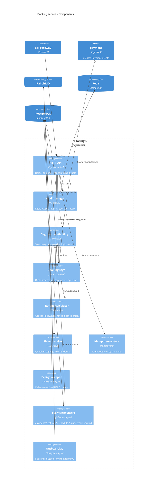
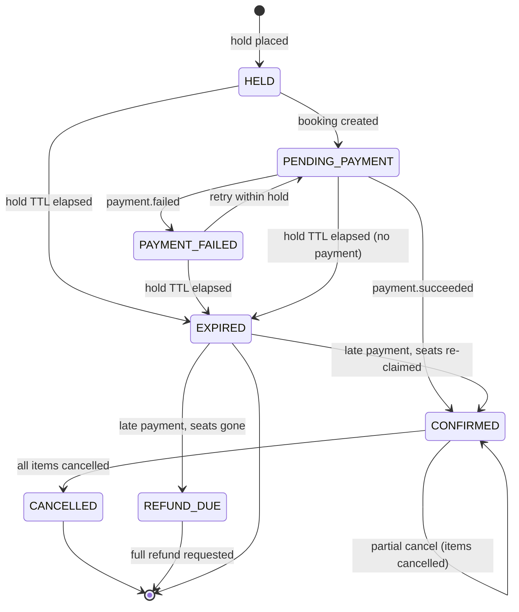
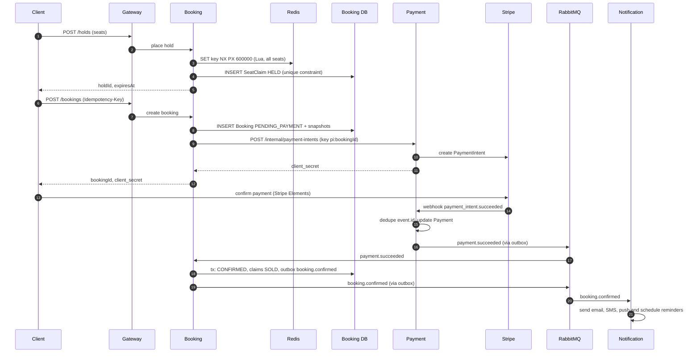

# TicketNest — Architecture

**Status:** Draft for review
**Date:** 2026-11-01
**Related:** [`prd.md`](./prd.md) · ADRs in [`adr/`](./adr/) (proposed list in §14)

Decisions marked **[Rec]** are recommended defaults chosen during drafting, not yet ratified. Each maps to an ADR in §14 so it can be challenged and recorded.

---

## 1. Purpose and scope

This document describes how TicketNest is decomposed into services, who owns which data, how services talk to each other, and how a booking stays correct when parts of the system fail. It covers service boundaries, data ownership, sync vs async communication, the booking saga, the transactional outbox, idempotency, and C4 diagrams. It does not cover UI design, API field-level specs, or infrastructure code.

## 2. Architectural drivers

Derived from PRD §5 and §6:

| Driver | Consequence |
|---|---|
| A seat can never be sold twice | Postgres is the arbiter for seat claims; Redis is only an accelerator |
| Money movement must be exactly-once in effect | Idempotency keys at every boundary, webhook dedupe, outbox/inbox |
| ~500 concurrent users, ~20 bookings/s with same-seat contention | Isolate the booking write path; cheap fail-fast on contention |
| Multiple operators (tenants) | `tenant_id` on operator-owned data, enforced centrally |
| Separate notification service with email, SMS, web push, reminders | Event-driven, no callbacks into other services |
| Solo developer, learning project | Few services, shared libraries for the hard parts, boring tech where possible |
| Standard observability, Kubernetes on AWS | Correlation IDs, metrics, health endpoints from day one |

---

## 3. C4 diagrams

Mermaid's C4 support is experimental. If a diagram fails to render in your viewer, the tables in §4–§5 are the source of truth.

### 3.1 System context (C4 level 1)



### 3.2 Containers (C4 level 2)

Per-service database links are condensed to one `PostgreSQL` node (one database per service); §5 is authoritative.



### 3.3 Booking service components (C4 level 3)



---

## 4. Service boundaries

| Service | Owns (behaviour) | Does not own |
|---|---|---|
| **api-gateway** (Express 5) | Routing, rate limiting, JWT verification, request-id injection, response aggregation for the two apps. TLS terminates at the ingress. | Business rules or data |
| **auth-service** | Users, roles, permissions, tenant membership, tokens, guest sessions, OTP | Bookings |
| **catalog** | Operators (tenants), venues, screens and layouts, movies, routes and stations, schedules (shows, trips, runs), prices, **cancellation policy and fee configuration**, search | Seat availability state |
| **booking** | Seat inventory state, holds, segment logic, bookings and passengers, booking state machine, cancellation computation, **saga orchestration**, tickets (QR token and PDF) | Money movement |
| **payment** | Stripe PaymentIntents, webhooks, payments, refunds, **refund approval queue** (support cap, admin approval) | Booking state |
| **notification** | Templates, channel preferences, email / SMS / web-push delivery, delivery status, **reminder scheduler** | Deciding *when* a business fact happened |
| **web** / **console** (Next.js) | UI only; call the gateway | Data |

**[Rec] Catalog and booking stay separate.** Catalog defines a *schedule* (layout, prices, segments). Booking materialises it into seat-inventory rows when it receives `schedule.published`. The high-contention write path (booking) is isolated from the read-heavy catalog, and neither can lock the other's tables.

**Rule of thumb for new features:** put logic in the service that owns the data it needs to be *consistent* with; use events for everything else.

---

## 5. Data ownership

**A service's database is private. No cross-service DB reads, no shared tables.** Other services get data through APIs or events.

| Service | Store | Key entities |
|---|---|---|
| auth-service | Postgres | User, Role, Permission, RolePermission, TenantMembership, RefreshToken, Otp (hashed), Outbox |
| catalog | Postgres | Operator, Venue, Screen, Movie, BusLayout, Route, Stop, Train, Station, Class, Coach, Schedule, Price, CancellationPolicy, Fee, Outbox |
| booking | Postgres + Redis | SeatInventory, **SeatClaim**, Booking, BookingItem (passenger), ScheduleSnapshot, PolicySnapshot, IdempotencyKey, Outbox, Inbox. Redis: hold keys with TTL, per-session counters |
| payment | Postgres | Payment, Refund, RefundRequest (approval), WebhookEvent (dedupe), Outbox, Inbox |
| notification | Postgres | Template, Preference, Notification, DeliveryAttempt, ScheduledNotification, Inbox |
| auth-service, gateway | Redis | OTP throttling, login and API rate limits |

### 5.1 Deliberate duplication (event-carried state transfer)

- **Snapshots in booking.** At hold time booking stores a *ScheduleSnapshot* (title, venue, times, timezone, price) and a *PolicySnapshot* (refund tiers, fee). Cancellation uses the snapshot, so a later policy edit never changes an existing booking's terms, and cancelling needs no synchronous call to catalog.
- **Fat events.** Events carry what consumers need (contact details, amount, ticket link, schedule summary), so notification never calls back into booking.
- **Guest-to-account merge.** The auth service emits `user.email_verified`; booking attaches `user_id` to bookings whose contact email matches and whose `user_id` is null.
- **Availability on listings.** Search results show "seats left". Catalog calls a booking batch endpoint (`POST /availability/batch`) with a short cache (5–10 s) rather than subscribing to every seat change.

### 5.2 Seat model (booking)

- `SeatInventory(scheduleId, seatId, …)` is created from `schedule.published`.
- `SeatClaim(scheduleId, seatId, segmentIndex, status, bookingId, expiresAt)` has a **unique constraint on (scheduleId, seatId, segmentIndex)** for active claims. Status is `HELD` or `SOLD`; a released claim is deleted (or moved to history).
- **Movies and buses:** one segment (index 0). **Trains:** one claim per segment the journey covers. A booking from station A to D claims segments A–B, B–C, C–D only, so the berth is free again for D–E. Overlap is therefore detected by the unique constraint with no special query.
- Prices are immutable once a schedule has any claim; a price change creates a new price version for future holds.

### 5.3 Deployment of data (AWS) **[Rec]**

One RDS PostgreSQL instance with one **database per service** and a dedicated DB user each. Real isolation for learning, without five instances' cost. One ElastiCache Redis with strict key prefixes per service. Both are called out in ADR-0003.

---

## 6. Communication: sync vs async

| Use sync REST | Use async events (RabbitMQ) |
|---|---|
| Queries: search, schedule detail, my bookings | State changes other services must react to |
| User-blocking commands: place hold, create booking | Payment result → booking |
| Booking → payment: create PaymentIntent (the client needs `client_secret` now); idempotent, with timeout and retry | Booking confirmed / cancelled / expired → notification |
| Gateway → services | Operator cancels a show or trip → fan-out to bookings |
| Availability counts for listings (batch endpoint + cache) | Refund requested / succeeded / failed |

**Rules**

1. Events state facts; REST asks questions.
2. No synchronous chain longer than one hop (gateway → service is not counted).
3. Every sync call has a timeout, bounded retries with jitter, and a circuit breaker (shared `packages/http-client`).
4. A service must still serve reads when its event consumers are behind.

### 6.1 RabbitMQ topology **[Rec]**

- **Topic exchanges** per producing domain: `auth.events`, `catalog.events`, `booking.events`, `payment.events`. Routing keys are event types, e.g. `booking.confirmed`.
- **One durable quorum queue per consuming service per exchange**, e.g. `notification.booking-events`.
- Persistent messages, **publisher confirms**, manual acks, bounded prefetch.
- Retry: on handler failure, route to a TTL retry queue with exponential backoff (e.g. 5 s → 30 s → 5 min), then to a per-consumer **dead-letter queue**. DLQ depth is alerted.

### 6.2 Event envelope

```json
{
  "id": "uuid",
  "type": "booking.confirmed",
  "version": 1,
  "occurredAt": "2026-11-01T10:00:00Z",
  "aggregateId": "booking-uuid",
  "aggregateVersion": 4,
  "correlationId": "uuid",
  "causationId": "uuid",
  "tenantId": "uuid | null",
  "data": { }
}
```

Schemas live in `packages/contracts` (Zod), versioned, with backward-compatible additions only. Breaking changes publish a new `version` alongside the old until consumers migrate.

### 6.3 Event catalogue (initial)

| Event | Producer | Consumers |
|---|---|---|
| `user.registered`, `user.email_verified` | auth-service | booking (merge), notification (welcome) |
| `schedule.published`, `schedule.updated`, `schedule.cancelled` | catalog | booking |
| `policy.updated` | catalog | (booking reads snapshots; informational) |
| `booking.confirmed`, `booking.cancelled`, `booking.expired`, `booking.partially_cancelled` | booking | notification, payment (reconciliation) |
| `refund.requested` | booking, payment (support) | payment |
| `payment.succeeded`, `payment.failed` | payment | booking |
| `refund.succeeded`, `refund.failed` | payment | booking, notification |
| `refund.approval_required` | payment | notification (to admins) |

---

## 7. Booking saga

**[Rec] Orchestration inside the booking service.** The booking is the process manager and its state machine is persisted. Choreography would scatter "what happens next" across three services, which is harder to reason about and test.

Booking status and refund status are **separate fields**: a booking is `CANCELLED` once, while its refund moves `PENDING → SUCCEEDED / FAILED` independently (the refund lives in payment).

### 7.1 State machine



Notes:
- Bus and train bookings support **partial cancellation per passenger**; the item status flips to `CANCELLED` and the booking becomes `CANCELLED` only when every item is. Movies are all-or-nothing.
- `REFUND_DUE` is an internal terminal state meaning "paid, cannot fulfil, `refund.requested` written".

### 7.2 Happy path



Step details:

1. **Hold (sync).** For each seat-segment, `SET key NX PX 600000` in Redis via one Lua script so a multi-seat hold is all-or-nothing. Then insert `SeatClaim(status=HELD, expiresAt)` in Postgres. **The unique constraint is the arbiter.** On conflict, roll back the Redis keys and return `409`. Redis is a fast pre-filter and a TTL signal; correctness never depends on it. A hold is bound to the user or the guest session (`sid`).
2. **Create booking (sync, idempotent).** Verify hold ownership, snapshot schedule and policy, insert `Booking(PENDING_PAYMENT)` and items, call payment with key `pi:{bookingId}`, and return `client_secret`. If payment is unreachable the call fails with `503`; the hold is kept and the client may retry with the same `Idempotency-Key`.
3. **Pay.** The client confirms the PaymentIntent with Stripe Elements. Card data never touches TicketNest servers.
4. **Webhook.** Payment verifies the Stripe signature, dedupes on `event.id`, updates the Payment, and writes `payment.succeeded` or `payment.failed` to its outbox.
5. **Confirm.** Booking consumes the event and, in a single transaction, sets `CONFIRMED` (guarded by `WHERE status IN ('PENDING_PAYMENT')`), flips claims to `SOLD`, and writes `booking.confirmed` to its outbox.
6. **Notify.** Notification consumes `booking.confirmed`, sends email (with ticket link), SMS and push, and schedules the 24 h and 2 h reminders.

### 7.3 Compensation paths

| Trigger | Action |
|---|---|
| Hold expires unpaid | A **sweeper** (every few seconds, `FOR UPDATE SKIP LOCKED`) deletes expired `HELD` claims and marks the booking `EXPIRED`, emitting `booking.expired`. Redis TTL is the fast path; the sweeper is the reliable one because keyspace notifications are not delivery-guaranteed. Resolves PRD open question 6. |
| `payment.failed` | Booking records the failed attempt. The hold stays until expiry so the user can retry (PRD §5.4). |
| `payment.succeeded` **after** the hold expired | Booking tries to **re-claim** the same seats atomically. If they are still free, it confirms. If not, it writes `refund.requested{reason: HOLD_EXPIRED, amount: 100% incl. fee}`; payment refunds; notification explains. |
| Customer or guest cancels | Booking computes the refund from the **PolicySnapshot**, sets items `CANCELLED`, deletes their claims, and writes `refund.requested`. Payment issues the Stripe refund with key `refund:{refundId}`. A webhook then yields `refund.succeeded` or `refund.failed`. |
| Operator cancels a show or trip | Catalog emits `schedule.cancelled`. Booking fans out in batches, cancelling every confirmed booking with a 100% refund including fees. Batches are rate-limited to protect Stripe and the DB. |
| Support goodwill refund | Payment's `RefundRequest`: within the cap it is auto-approved; above the cap it waits for `refund:approve` (admin). Everything is audit-logged. |
| `refund.failed` | Retried with backoff; then it appears in the support queue and raises an alert. |

Booking events and refund events are separate facts. Notification reacts to each.

---

## 8. Transactional outbox and inbox

### 8.1 Outbox (producer side)

Every service that publishes events has an outbox:

```
outbox(
  id uuid pk, aggregate_type, aggregate_id, aggregate_version,
  type, payload jsonb, headers jsonb,
  created_at, published_at null, attempts int
)
```

- Rows are written **in the same database transaction** as the state change (Prisma `$transaction`). The shared helper takes the transaction client, so business code cannot publish without it.
- **[Rec] Polling relay, in-process.** Select unpublished rows `FOR UPDATE SKIP LOCKED` in batches, publish with publisher confirms, then set `published_at`. Order per aggregate by `aggregate_version`. Several replicas can run the relay safely.
- Delivery is **at-least-once**: a crash between publish and mark causes a duplicate. Consumers must tolerate duplicates (§8.2).
- A janitor deletes published rows after N days.
- Alternative considered: CDC with Debezium. Rejected for now as heavy infrastructure for a solo project; ADR-0007 records the trade-off.

### 8.2 Inbox (consumer side)

```
inbox(message_id, consumer, processed_at, unique(message_id, consumer))
```

A handler runs in **one transaction**: insert the inbox row, apply the effect, write any outbox events. A duplicate message violates the unique constraint, is acked, and is skipped.

**Out-of-order tolerance.** Handlers rely on guarded state transitions (`UPDATE … WHERE status = …`) and `aggregate_version` rather than assuming ordering across queues.

### 8.3 Shared library

`packages/messaging` provides the outbox writer, relay, inbox wrapper, retry/DLQ topology, and envelope helpers, so each service gets this behaviour by configuration rather than by copy-paste.

---

## 9. Idempotency strategy

| Boundary | Mechanism |
|---|---|
| Client → API (create booking, cancel, request refund) | `Idempotency-Key` header. Table `idempotency_key(key, scope, request_hash, status, response, expires_at)`. Replay returns the stored response; the same key with a different body returns `422`; a concurrent duplicate returns `409` while the first is in progress. |
| Service → Stripe | Deterministic Stripe idempotency keys: `pi:{bookingId}:{attempt}`, `refund:{refundId}`. |
| Stripe webhook → payment | Dedupe on `event.id` (unique `WebhookEvent`). Handlers apply forward state transitions only, so out-of-order delivery is harmless. |
| Event consumers | Inbox table plus guarded state transitions. |
| Seat claims | Unique constraint on (schedule, seat, segment). A retried hold by the same session is a no-op returning the existing hold. |
| Notifications | Unique dedupe key `{eventId}:{channel}:{recipient}`; provider idempotency where supported. |
| Reminders | Removed by `booking.cancelled`; the status is re-checked at send time as a second guard. |

Idempotency keys expire after 24 h. Keys are scoped per user or guest session so one caller cannot replay another's.

---

## 10. Cross-cutting decisions

- **AuthN/AuthZ [Rec].** Asymmetric JWT (EdDSA or RS256) issued by the auth service with a JWKS endpoint. The gateway **and** every service verify the token (zero trust). Access tokens last 10 minutes and carry `sub`, `role`, `permissions[]`, and `tenantId`; refresh tokens rotate with reuse detection. Permission edits take effect within one token lifetime.
- **Guests.** The auth service issues an anonymous session token; holds bind to its `sid`. After email OTP it issues a short-lived email-proof token. The auth service holds no booking data, so the **booking service** checks that the booking reference and contact email match before authorising view or cancel.
- **Multi-tenancy.** `tenant_id` on every operator-owned row, enforced in a shared repository layer with tests that fail on unscoped queries. Postgres RLS is evaluated in ADR-0015.
- **Money and time.** Money is integer minor units (cents), never floats. Timestamps are UTC; the IANA timezone is stored on venue and station and used for display and for cutoff and refund-window calculations.
- **API style.** REST with OpenAPI, RFC 9457 problem-details errors, cursor pagination, Zod validation shared through `packages/contracts`.
- **Observability (PRD "standard").** pino JSON logs; `x-request-id` / `correlationId` propagated through HTTP headers and event headers; Prometheus metrics (RED per service plus seat-hold contention rate, outbox lag, DLQ depth, hold-to-confirm conversion); `/healthz` and `/readyz` on every service.
- **Resilience.** Timeouts, retries with jitter, circuit breakers on sync calls, and a bulkhead around the operator-cancel fan-out so it cannot starve live bookings.

---

## 11. Failure-scenario walkthrough

| # | Scenario | What happens | Why it is safe |
|---|---|---|---|
| 1 | Two users click the same seat in the same millisecond | Both attempt the Redis `NX` and the DB insert; one wins, the other gets `409` | DB unique constraint is the arbiter |
| 2 | Redis is flushed or restarted mid-hold | Redis keys vanish; DB claims remain | Claims still block other holds; the sweeper expires them by `expiresAt` |
| 3 | Outbox relay crashes after publish, before marking | The row is republished | Consumers dedupe via inbox |
| 4 | Consumer crashes mid-handler | The transaction rolls back; message redelivered | Inbox row and effect commit together |
| 5 | Stripe webhook delivered twice or out of order | Duplicate ignored by `event.id`; stale event cannot move state backwards | Dedupe plus forward-only transitions |
| 6 | Payment succeeds after the hold expired, seats taken | Booking cannot re-claim; writes `refund.requested` (100% incl. fee) | Customer is always made whole; no oversell |
| 7 | User double-clicks Pay or the client retries the request | Same `Idempotency-Key` returns the stored response; Stripe key prevents a second intent | Idempotency at API and Stripe layers |
| 8 | Operator cancels a show while payments are in flight | In-flight payments confirm or fail first; the fan-out then cancels all `CONFIRMED` bookings. A payment landing after cancellation hits a cancelled schedule and is auto-refunded | Schedule status is checked at confirm; refund path is idempotent |
| 9 | Payment service is down during booking creation | `503` to client; hold and booking row persist | Client retries with the same key; hold expiry bounds the wait |
| 10 | Stripe refund fails | `refund.failed` is retried with backoff, then surfaces to support and alerts | Refund state is tracked and visible; never silently lost |
| 11 | Notification provider outage | Retries, then DLQ; the booking is unaffected | Notification is a leaf consumer with no callbacks |
| 12 | Booking service crashes after charging, before confirm | Event waits in the queue; processed on restart | At-least-once delivery plus idempotent confirm |

---

## 12. PRD traceability

| PRD item | Owner | Where |
|---|---|---|
| §5.1 Identity, JWT, OTP, RBAC | auth-service | §10 |
| §5.2 Catalog and inventory | catalog (definitions), booking (state) | §4, §5.2 |
| §5.3 Seat holds, limits, cutoffs | booking | §5.2, §7.2 |
| §5.3 Train segment booking | booking | §5.2 |
| §5.3 Women-reserved seats, passenger details | booking (validation), catalog (seat flags) | §5.2 |
| §5.4 Booking and payment, Stripe | booking (saga), payment | §7 |
| §5.4 Payment edge cases | booking, payment | §7.3 |
| §5.5 Cancellation tiers, partial cancel | booking (calc), catalog (policy source) | §5.1, §7.3 |
| §5.5 Operator-initiated cancel | catalog event, booking fan-out | §7.3 |
| §5.5 Support goodwill refunds, cap, approval | payment | §7.3 |
| §5.6 Notifications, reminders | notification | §6.3, ADR-0019 |
| §5.7 Tickets and QR | booking | §3.3, ADR-0024 |
| §5.8 Admin and operator portal | console, via gateway | §3.2 |
| §6 Scale, performance | booking isolation, Redis pre-filter | §2, §7.2 |
| §6 Consistency | outbox, inbox, idempotency | §8, §9 |
| §6 Security | JWT, rate limits, audit log | §10 |
| §6 Observability | all services | §10 |
| §6 Testing | all services | ADR-0022 |
| §6 Delivery on AWS / Kubernetes | all | §13 |

### 12.1 Proposed PRD follow-ups

Small edits to `prd.md` that this design surfaces. Not yet applied.

1. §5.4: split booking status from refund status.
2. §14, open question 6: resolved (sweeper plus Redis TTL).
3. §7: gateway **and** services verify JWTs; ticket generation lives in booking.
4. Add an email-provider assumption (AWS SES, since the target is AWS).
5. Clarify that a late payment still confirms the booking if the seats are free.
6. §5.5: a late-paid booking whose seats are gone is refunded 100% including fee.

---

## 13. Deployment view (brief)

- Each service and each Next.js app ships as a container image built in CI (GitHub Actions) with a pnpm/Turborepo-aware Dockerfile.
- Local development: Docker Compose runs Postgres, Redis, RabbitMQ and the services.
- AWS target **[Rec]**: EKS for workloads, RDS PostgreSQL (one instance, database per service), ElastiCache Redis, Amazon MQ for RabbitMQ (or self-managed in-cluster for cost), ALB ingress, Secrets Manager for credentials, Terraform for infrastructure. Details in ADR-0023.
- Each service exposes `/healthz` (liveness) and `/readyz` (readiness, checks DB and broker) for Kubernetes probes. The outbox relay and sweeper run in every replica and are safe to run concurrently thanks to `SKIP LOCKED`.

---

## 14. Proposed ADRs

Format: MADR, stored as `docs/adr/NNNN-title.md`.

**Write before any code (blocking)**

| # | Title |
|---|---|
| 0001 | Monorepo with pnpm + Turborepo and repo layout |
| 0002 | Service decomposition and boundaries |
| 0003 | Database per service on a shared RDS instance (Prisma per service) |
| 0004 | Communication rules: sync REST vs async events; resilience policy |
| 0005 | RabbitMQ topology: exchanges, quorum queues, retry and DLQ |
| 0006 | Booking saga: orchestration in the booking service |
| 0007 | Transactional outbox (polling relay) and inbox |
| 0008 | Idempotency strategy across boundaries |
| 0009 | Seat concurrency: Redis hold + Postgres arbiter + sweeper |
| 0010 | Train segment-based availability model |
| 0011 | Event contracts: envelope, Zod schemas, versioning |
| 0012 | Money and time handling (minor units, UTC, IANA zones) |

**Write alongside the relevant milestone**

| # | Title |
|---|---|
| 0013 | AuthN/AuthZ: asymmetric JWT, refresh rotation, permission claims |
| 0014 | Guest identity, OTP booking lookup, guest-to-account merge |
| 0015 | Multi-tenancy enforcement (repository layer vs Postgres RLS) |
| 0016 | API style: REST + OpenAPI, problem details, pagination, gateway/BFF role |
| 0017 | Stripe integration: PaymentIntents, webhooks, refunds, USD |
| 0018 | Cancellation policy modelling and snapshotting |
| 0019 | Notification service: provider abstraction, templates, DB-backed reminder scheduler |
| 0020 | Search and read models: Postgres filters, availability batch endpoint and cache |
| 0021 | Observability stack and conventions |
| 0022 | Testing strategy: pyramid, Testcontainers, contract tests, k6 |
| 0023 | Deployment: Docker, EKS, Terraform, secrets, ingress, CI/CD |
| 0024 | Ticket generation and QR token signing |

---

## 15. Open questions

1. **Booking → payment sync call.** Alternative: the client fetches the `client_secret` from payment after booking creation (fully async, extra round trip). Recommended: sync, as written. Confirm in ADR-0004.
2. **RabbitMQ on AWS.** Amazon MQ (managed, higher cost) vs self-managed in the cluster (cheaper, more operational work).
3. **Reminder mechanism.** DB-backed scheduler in notification (recommended, cancellable) vs RabbitMQ delayed messages.
4. **Ticket PDF generation.** On demand in booking (recommended) vs pre-rendered and stored in S3.
5. **RLS vs application-level tenant scoping** for operator data.
